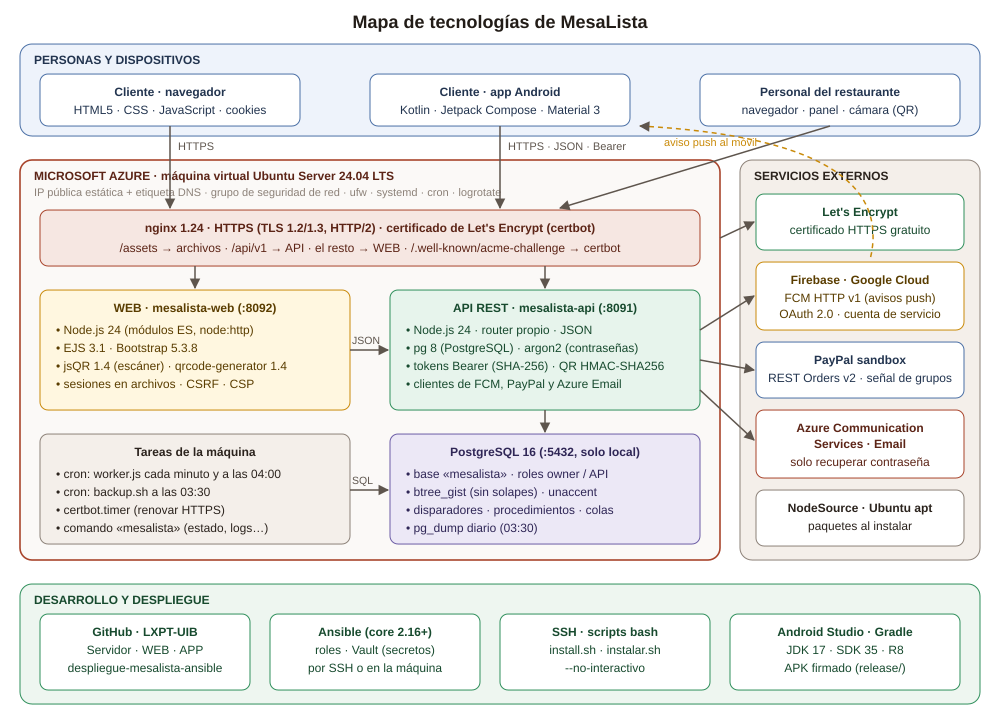
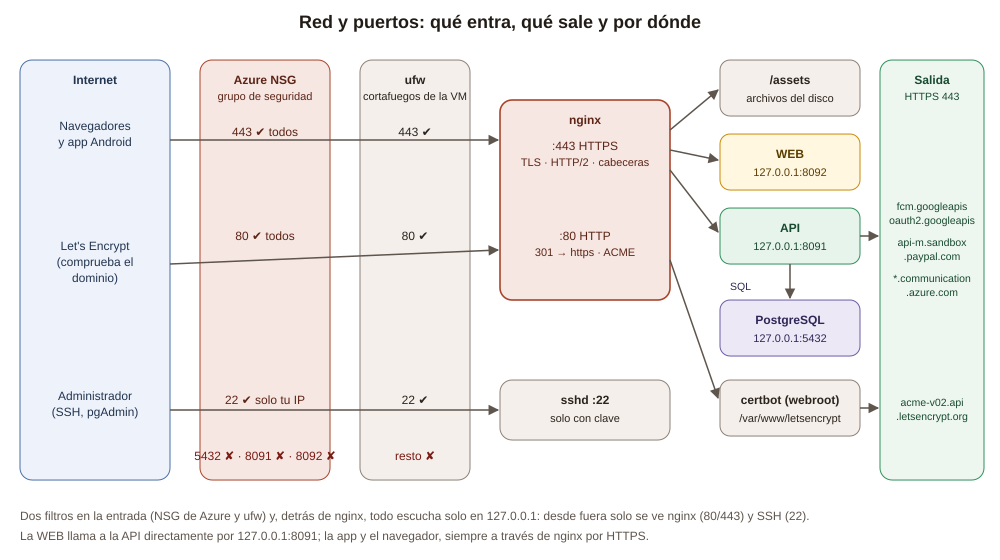
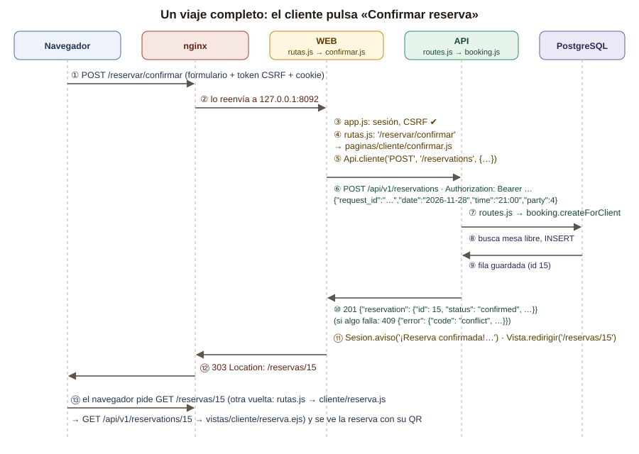
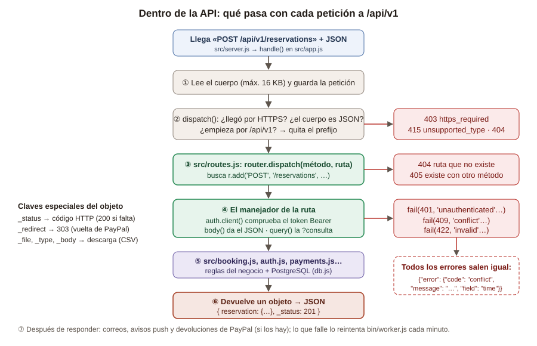
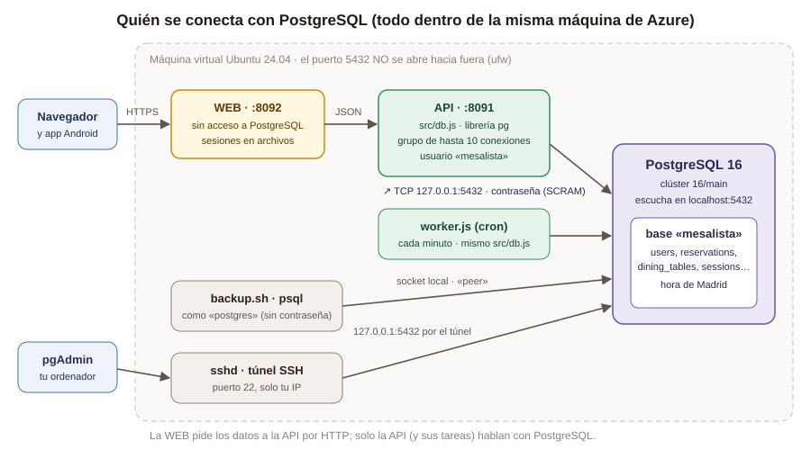
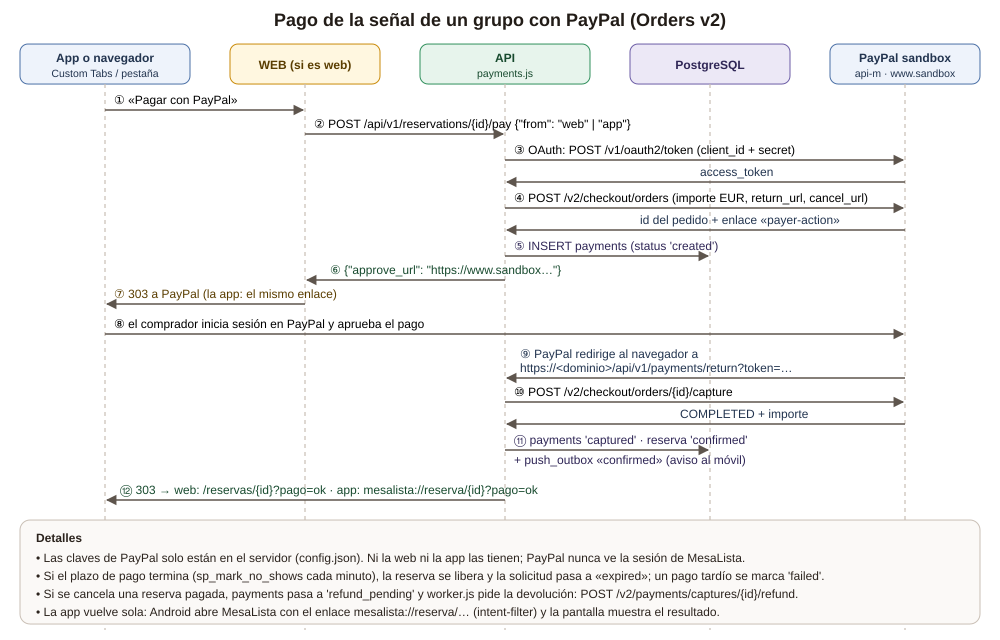
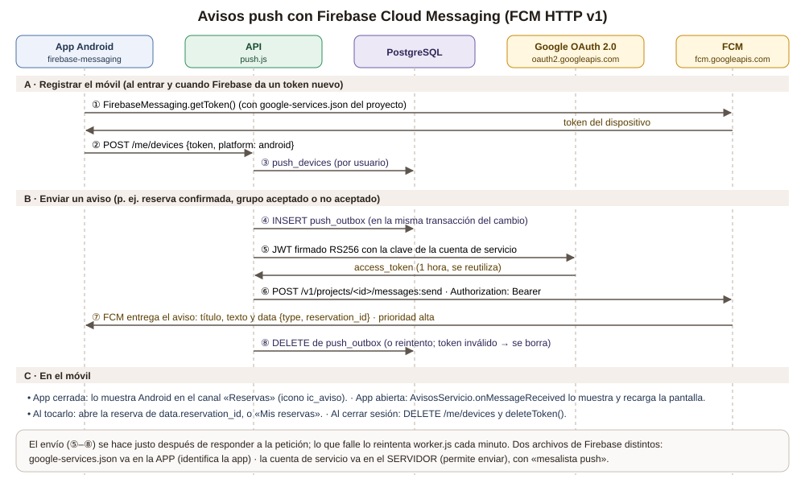
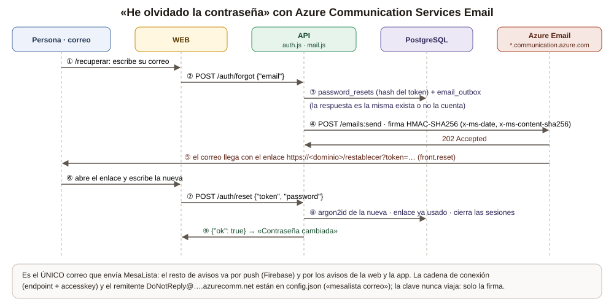
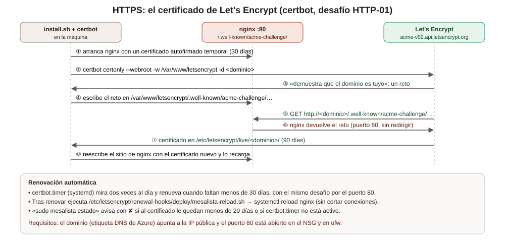
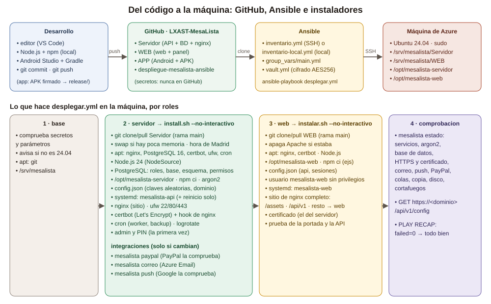

# MesaLista: cómo se integran todas sus tecnologías

Este documento reúne **todas las tecnologías** que usa MesaLista y explica cómo
encajan: dónde se ejecuta cada una, cómo se comunican, qué datos se
intercambian, dónde están los secretos y cómo se despliega todo. Cada flujo
importante tiene su diagrama.

Repositorios: [LXPT-UIB/Servidor](https://github.com/LXPT-UIB/Servidor) (API y
base de datos), [LXPT-UIB/WEB](https://github.com/LXPT-UIB/WEB) (web y panel),
[LXPT-UIB/APP](https://github.com/LXPT-UIB/APP) (app Android) y
[LXPT-UIB/despliegue-mesalista-ansible](https://github.com/LXPT-UIB/despliegue-mesalista-ansible)
(despliegue).

---

## 1. Visión general

MesaLista es un sistema de reservas de mesas con tres partes visibles y una
central:

| Parte | Quién la usa | Tecnología principal |
|---|---|---|
| **Web de clientes** | Clientes, desde el navegador | Node.js + plantillas EJS + Bootstrap |
| **Panel del restaurante** | Personal y administración | La misma web (zona `/panel`) |
| **App Android** | Clientes, desde el móvil | Kotlin + Jetpack Compose + Firebase |
| **API REST** (el centro) | La web y la app | Node.js + PostgreSQL |

**Regla de diseño:** todas las reglas del negocio (horas libres, mesas, plazos,
pagos, QR) están **solo en la API**. La web y la app muestran lo que responde la
API y le envían lo que hace la persona. Así se comportan igual y nadie puede
saltarse una regla modificando el navegador o la app.

---

## 2. Inventario de tecnologías

### 2.1 Infraestructura (Microsoft Azure)

| Tecnología | Versión | Para qué | Cómo se integra |
|---|---|---|---|
| **Azure Virtual Machine** | — | Ejecuta todo el servidor | Una sola máquina para la web, la API y la base de datos |
| **Ubuntu Server** | 24.04 LTS | Sistema operativo | Los instaladores comprueban la versión |
| **IP pública estática + etiqueta DNS** | — | Dirección fija y dominio (`mesalista.spaincentral.cloudapp.azure.com`) | El dominio va en `install.env` y `config.json`; Let's Encrypt lo comprueba |
| **Grupo de seguridad de red (NSG)** | — | Cortafuegos de Azure | 80 y 443 abiertos; 22 solo desde la IP del administrador |
| **ufw** | Ubuntu | Cortafuegos de la máquina | `install.sh` abre solo 22, 80 y 443 |
| **systemd** | Ubuntu | Arranca y vigila los servicios | `mesalista-api`, `mesalista-web`, `nginx`, `postgresql@16-main`, con reinicio automático |
| **cron** | Ubuntu | Tareas periódicas | `worker.js` cada minuto y a las 04:00; `backup.sh` a las 03:30 |
| **logrotate** | Ubuntu | Rota los registros | `/var/log/mesalista/*.log`, semanal, 4 copias |
| **swap** | — | Memoria extra en máquinas pequeñas | 1 GB si la máquina tiene menos de 1,6 GB |

### 2.2 Entrada HTTPS

| Tecnología | Versión | Para qué | Cómo se integra |
|---|---|---|---|
| **nginx** | 1.24 | Recibe todo el tráfico | HTTPS (TLS 1.2/1.3, HTTP/2); sirve `/assets` y reenvía `/api/v1` a la API y el resto a la web |
| **Let's Encrypt** | ACME v2 | Certificado HTTPS gratuito | Desafío HTTP-01 por el puerto 80 |
| **certbot** | Ubuntu | Pide y renueva el certificado | `--webroot` en `/var/www/letsencrypt`; `certbot.timer` renueva; un *hook* recarga nginx |
| **OpenSSL** | Ubuntu | Certificado autofirmado temporal | Mientras no hay certificado de Let's Encrypt |

### 2.3 Servidor (API REST)

| Tecnología | Versión | Para qué | Cómo se integra |
|---|---|---|---|
| **Node.js** | 24 (NodeSource) | Ejecuta la API | `node:http`, router propio, módulos ES, `AsyncLocalStorage` por petición |
| **pg** (node-postgres) | 8.13 | Conexión con PostgreSQL | Grupo de 10 conexiones; consultas con parámetros |
| **argon2** | 0.41 | Contraseñas y PIN | Argon2id; se comprueba que el binario carga al instalar |
| **node:crypto** | Node.js | Hashes y firmas | SHA-256 de tokens; HMAC-SHA256 del QR y de Azure Email; JWT RS256 de Firebase |
| **JSON / REST** | — | Contrato con la web y la app | `/api/v1`, documentado en `docs/openapi.yaml` (OpenAPI 3) |

### 2.4 Base de datos

| Tecnología | Versión | Para qué | Cómo se integra |
|---|---|---|---|
| **PostgreSQL** | 16 | Todos los datos | Solo en `localhost:5432`; roles `mesalista_owner` (dueño) y `mesalista` (API) |
| **btree_gist** | extensión | Restricción de exclusión | Impide dos reservas solapadas en la misma mesa |
| **unaccent** | extensión | Búsqueda sin tildes | Buscar clientes por nombre |
| **PL/pgSQL** | — | Disparadores y procedimientos | `sp_mark_no_shows`, `sp_daily_purge`, ocupación de mesas |
| **pg_dump / pg_restore** | 16 | Copias de seguridad | `backup.sh` diario; `restore.sh` |

### 2.5 Web y panel

| Tecnología | Versión | Para qué | Cómo se integra |
|---|---|---|---|
| **Node.js** | 24 | Servidor de la web | `node:http`; una página `.js` por dirección (`src/rutas.js`) |
| **EJS** | 3.1.10 | Plantillas HTML | `vistas/*.ejs`, dentro de `base.ejs` |
| **Bootstrap** | 5.3.8 | Estilos y componentes | Servido desde la propia web (sin CDN) |
| **jsQR** | 1.4.0 | Leer QR con la cámara | Panel > Escanear QR |
| **qrcode-generator** | 1.4.4 | Dibujar el QR de la reserva | En el navegador del cliente |
| **Cookies + sesiones en archivos** | — | Sesión de la web | Cookie `mlweb` (HttpOnly, SameSite, Secure); el token de la API se guarda en el servidor |
| **CSP, CSRF** | — | Seguridad del navegador | Sin scripts en línea; token CSRF en cada formulario |

### 2.6 App Android

| Tecnología | Versión | Para qué | Cómo se integra |
|---|---|---|---|
| **Kotlin** | 2.0.21 | Lenguaje | — |
| **Jetpack Compose + Material 3** | BOM 2024.12.01 | Pantallas | Una función `…Pantalla` y un `…VM` (ViewModel) por pantalla |
| **Navigation Compose** | 2.8.5 | Ir entre pantallas | `ui/Navegacion.kt` |
| **OkHttp** | 4.12.0 | Llamadas HTTPS a la API | `datos/Api.kt`, token Bearer |
| **Corrutinas de Kotlin** | 1.9.0 | Red sin bloquear la pantalla | `viewModelScope.launch` |
| **Android Keystore (AES-GCM)** | — | Guardar el token cifrado | `datos/Sesion.kt` |
| **ZXing** | 3.5.3 | Dibujar el QR | Solo lo dibuja; lo genera y firma el servidor |
| **Custom Tabs** (androidx.browser) | 1.8.0 | Abrir PayPal | Pestaña del navegador del sistema, no un WebView |
| **Firebase Cloud Messaging** | BOM 33.7.0 | Recibir avisos push | `google-services.json` + `AvisosServicio.kt` |
| **Gradle + Android Gradle Plugin** | AGP 8.7.3 | Compilar | JDK 17, SDK 35, mínimo Android 8.0; R8 en la versión final |

### 2.7 Servicios externos

| Servicio | Para qué | Quién lo llama | Autenticación |
|---|---|---|---|
| **Firebase Cloud Messaging (HTTP v1)** | Avisos push a los móviles | La API (`src/push.js`) | OAuth 2.0 con la cuenta de servicio (JWT RS256) |
| **Google OAuth 2.0** | Token de acceso para FCM | La API | JWT firmado con la clave privada de la cuenta de servicio |
| **PayPal REST (sandbox), Orders v2** | Cobrar y devolver la señal de los grupos | La API (`src/payments.js`) | OAuth 2.0 *client credentials* (Client ID + Secret) |
| **Azure Communication Services Email** | Correo de «He olvidado la contraseña» | La API (`src/mail.js`) | Firma HMAC-SHA256 con la clave del recurso |
| **Let's Encrypt** | Certificado HTTPS | certbot | Cuenta ACME con el correo del administrador |
| **NodeSource / Ubuntu apt** | Paquetes al instalar | Los instaladores | Firmas GPG de los repositorios |

### 2.8 Desarrollo y despliegue

| Tecnología | Para qué |
|---|---|
| **Git + GitHub** (organización LXPT-UIB) | Código de las cuatro partes |
| **Bash** (`install.sh`, `instalar.sh`, `backup.sh`…) | Instaladores y tareas de la máquina; modo `--no-interactivo` para automatizar |
| **Ansible** (core 2.16 o posterior) + **Ansible Vault** | Desplegar todo con una orden, con los secretos cifrados |
| **SSH** (clave `.pem`) | Entrar en la máquina, Ansible y túneles (pgAdmin) |
| **pgAdmin 4** | Ver la base de datos, por un túnel SSH |
| **Android Studio** | Programar y compilar la app |
| **VS Code / npm** | Programar la web y la API |

---

## 3. Red y puertos

| Puerto | Quién escucha | Abierto a | Para qué |
|---|---|---|---|
| **443** | nginx | Todos | HTTPS: web, panel, API |
| **80** | nginx | Todos | Redirige a HTTPS; desafío de Let's Encrypt |
| **22** | sshd | Solo la IP del administrador (NSG) | Administración, Ansible, túnel de pgAdmin |
| 8092 | WEB (Node.js) | Solo `127.0.0.1` | nginx → web |
| 8091 | API (Node.js) | Solo `127.0.0.1` | nginx → API y web → API |
| 5432 | PostgreSQL | Solo `localhost` | API y tareas → base de datos |

Conexiones de **salida** (todas por HTTPS 443): `fcm.googleapis.com`,
`oauth2.googleapis.com`, `api-m.sandbox.paypal.com`,
`*.communication.azure.com`, `acme-v02.api.letsencrypt.org`, GitHub y los
repositorios de paquetes.

---

## 4. Quién habla con quién

| De | A | Protocolo | Formato | Autenticación | Código |
|---|---|---|---|---|---|
| Navegador | nginx → WEB | HTTPS | HTML + formularios | Cookie de sesión + token CSRF | `WEB/src/app.js` |
| Navegador (panel) | WEB `/ajax/…` | HTTPS | JSON | Cookie + `X-CSRF-Token` | `WEB/publico/assets/js/panel.js` |
| WEB | API | HTTP local (127.0.0.1:8091) | JSON | `Authorization: Bearer` + `X-Forwarded-For` | `WEB/src/lib/api.js` |
| App Android | nginx → API | HTTPS | JSON | `Authorization: Bearer` | `APP/…/datos/Api.kt` |
| API | PostgreSQL | Protocolo de PostgreSQL (TCP local) | SQL con parámetros | SCRAM-SHA-256 | `Servidor/src/db.js` |
| API | Google OAuth + FCM | HTTPS | JSON | JWT RS256 → token Bearer | `Servidor/src/push.js` |
| FCM | App Android | Conexión de Google Play Services | Notificación + `data` | Token del dispositivo | `APP/…/AvisosServicio.kt` |
| API | PayPal | HTTPS | JSON | OAuth *client credentials* | `Servidor/src/payments.js` |
| PayPal | API (vuelta) | HTTPS (redirección del navegador) | `?token=<pedido>` | Solo pedidos que creó el servidor | `GET /api/v1/payments/return` |
| API | App (vuelta de PayPal) | Enlace `mesalista://reserva/{id}?pago=…` | — | La app valida el enlace | `APP/…/datos/Enlaces.kt` |
| API | Azure Email | HTTPS | JSON | HMAC-SHA256 | `Servidor/src/mail.js` |
| certbot | Let's Encrypt | HTTPS (ACME) + HTTP (desafío) | — | Cuenta ACME | `install.sh` |
| Ansible | Máquina | SSH (o local) | Módulos de Ansible | Clave SSH + `sudo` | `despliegue-mesalista-ansible/roles/` |

---

## 5. Los flujos, paso a paso

### 5.1 Una petición completa: reservar una mesa

El navegador envía el formulario a la WEB. La WEB lo pasa a la API con el token
de la sesión. La API comprueba las reglas y, en una transacción de PostgreSQL,
bloquea las mesas, elige una y guarda la reserva. Después responde, y la WEB
redirige a la página de la reserva con su QR. Este flujo se explica con detalle
en `docs/manual-rutas.md`.

### 5.2 Dentro de la API

### 5.3 La API y PostgreSQL

Detalle de usuarios, mensajes del protocolo y transacciones: `docs/manual-base-de-datos.md`.

### 5.4 Pago de la señal con PayPal

Puntos clave:

- Solo pagan señal las **solicitudes de grupo aceptadas**. El importe es la
  señal por persona (Administración > Parámetros) por el número de comensales.
- La reserva queda `pending_payment` con un plazo. Si no se paga a tiempo,
  `sp_mark_no_shows` la libera y la solicitud pasa a `expired`.
- El pedido (`payments.order_id`) es único: no se cobra dos veces.
- La vuelta es distinta según desde dónde se pagó (`front.payment_web` o
  `front.payment_app` de `config.json`).

### 5.5 Avisos push con Firebase

Puntos clave:

- **Dos archivos distintos de Firebase:** `google-services.json` en la **app**
  (identifica la app ante Firebase) y la **cuenta de servicio** en el
  **servidor** (le da permiso para enviar avisos).
- Los avisos se guardan en `push_outbox` **dentro de la transacción** del
  cambio: si el cambio se deshace, no sale ningún aviso.
- Tipos (`data.type`): `confirmed`, `modified`, `cancelled_holder`,
  `cancelled_restaurant`, `group_accepted`, `group_rejected`, `payment_expired`.
- Los avisos solo llevan fecha, hora y comensales: nunca el QR, el menú ni la nota.

### 5.6 Correo para restablecer la contraseña

### 5.7 HTTPS con Let's Encrypt

### 5.8 Tareas automáticas

| Cuándo | Qué | Tecnologías |
|---|---|---|
| Cada minuto | `worker.js`: no presentadas y señales vencidas (`CALL sp_mark_no_shows`), devoluciones de PayPal, correos y avisos pendientes | cron → Node.js → PostgreSQL, PayPal, Azure Email, FCM |
| 03:30 | `backup.sh`: `pg_dump` + `config.json` → `/var/backups/mesalista` (14 días) | cron → bash → PostgreSQL |
| 04:00 | `worker.js --diario`: borrado de datos personales caducados (`CALL sp_daily_purge`) | cron → Node.js → PostgreSQL |
| 2 veces al día | `certbot renew` (si faltan menos de 30 días) y recarga de nginx | systemd timer → certbot → Let's Encrypt |
| Cada 2 segundos (panel abierto) | `GET /ajax/panel/version` → `GET /api/v1/panel/version`: recarga la sala si cambia algo | JavaScript del navegador → WEB → API |

---

## 6. Identidades y secretos

| Secreto | Dónde está | Quién lo usa | Protección |
|---|---|---|---|
| Contraseñas de las cuentas | `users.password_hash` | API | Argon2id; nunca en claro |
| Tokens de sesión (Bearer) | Cliente: Android Keystore o sesión de la web. Servidor: `sessions.token_hash` | API, web, app | El servidor solo guarda el SHA-256; caducan (60 min clientes, 8 h panel) |
| Sesión de la web | Cookie `mlweb` + archivo en `/var/lib/mesalista-web/sesiones` | WEB | Cookie HttpOnly, SameSite, Secure; archivo con permisos 600 |
| `qr_secret` | `config.json` | API | Firma HMAC-SHA256 de cada QR; si cambia, los QR antiguos dejan de valer |
| Contraseña de PostgreSQL (`db.pass`) | `config.json` | API, worker | Aleatoria (48 caracteres); `config.json` solo lo leen root y mesalista |
| PIN de «Cerrar local» | `secrets` | API | Argon2id; bloqueo tras varios fallos |
| Claves de PayPal | `config.json` (`paypal`) | API | Solo en el servidor; `mesalista paypal` las comprueba antes de guardarlas |
| Cadena de conexión de Azure Email | `config.json` (`mail`) | API | La clave no viaja: solo la firma de cada petición |
| Cuenta de servicio de Firebase | `config.json` (`fcm`) | API | `mesalista push`; el archivo original se borra después |
| `google-services.json` | App (`app/`, fuera de Git) | App | No es secreto, pero no se sube a Git |
| Clave de firma del APK | `keystore/` + `keystore.properties` (fuera de Git) | Gradle | Sin ella no se pueden publicar actualizaciones |
| Secretos del despliegue | `vault.yml` del proyecto de Ansible (fuera de Git) | Ansible | Cifrado AES-256 con Ansible Vault |
| Clave SSH | Ordenador del administrador | SSH, Ansible, pgAdmin | Solo desde la IP permitida en el NSG |

---

## 7. Despliegue

| Servicio (systemd) | Programa | Usuario | Escucha |
|---|---|---|---|
| `mesalista-api` | `node /opt/mesalista-servidor/src/server.js` | `mesalista` | 127.0.0.1:8091 |
| `mesalista-web` | `node /opt/mesalista-web/src/servidor.js` | `mesalista-web` | 127.0.0.1:8092 |
| `nginx` | nginx | `www-data` | 0.0.0.0:80 y :443 |
| `postgresql@16-main` | PostgreSQL 16 | `postgres` | localhost:5432 |
| `cron` | Tareas de `/etc/cron.d/mesalista` | `mesalista` y `root` | — |

Tres formas de instalar, con el mismo resultado:

1. **A mano**, en la máquina: `sudo bash despliegue/install.sh` (Servidor) y
   `sudo bash despliegue/instalar.sh` (WEB), con preguntas.
2. **Con Ansible desde tu ordenador**, por SSH: `ansible-playbook desplegar.yml --ask-vault-pass`.
3. **Con Ansible dentro de la máquina**: `ansible-playbook -i inventario-local.yml desplegar.yml --ask-vault-pass`.

La **app** se compila aparte con Gradle (`./gradlew assembleRelease`), se firma
con la clave del proyecto y se publica como APK en `release/` del repositorio APP.

---

## 8. Seguridad por capas

| Capa | Medidas |
|---|---|
| **Red** | NSG de Azure y ufw; solo 22, 80 y 443; los servicios internos solo en 127.0.0.1 |
| **Transporte** | HTTPS con Let's Encrypt (TLS 1.2/1.3); HSTS; la app solo acepta HTTPS con certificados del sistema |
| **Entrada** | nginx limita el tamaño del cuerpo; la API solo acepta JSON y HTTPS; la WEB solo GET, HEAD y POST |
| **Navegador** | CSP sin scripts en línea, `X-Frame-Options: DENY`, `no-store`, cookie HttpOnly/SameSite/Secure, token CSRF, escapado de HTML (EJS) |
| **Identidad** | Argon2id; tokens con caducidad; solo el hash en el servidor; bloqueo tras intentos fallidos (por persona, con la IP real) |
| **Autorización** | Cada ruta de la API comprueba su rol (cliente, personal, administración); un cliente solo ve sus reservas |
| **Datos** | Consultas con parámetros (sin inyección SQL); rol de la API sin permisos de estructura; transacciones; restricción de exclusión contra reservas solapadas |
| **QR** | Firmado con HMAC-SHA256 y con versión: uno alterado o antiguo no vale |
| **Pagos** | Claves solo en el servidor; pedidos únicos; pago en la página de PayPal (Custom Tabs o navegador) |
| **Privacidad** | Nota y menú solo con consentimiento; borrado diario de datos caducados; registros sin datos personales ni consultas |
| **Secretos** | `config.json` 640 (root:mesalista); Ansible Vault; nada secreto en Git |
| **Disponibilidad** | systemd reinicia los servicios; copias diarias; colas con reintento para correo, push y devoluciones |

---

## 9. Qué pasa si falla una pieza

| Falla | Qué nota la persona | Qué hace el sistema |
|---|---|---|
| **PostgreSQL** se para | Errores al cargar las páginas | systemd lo reinicia; la API descarta las conexiones rotas y abre otras |
| **API** se para | La web dice «No se puede conectar con el servidor de reservas»; la app, «No se puede conectar» | systemd la reinicia en 2 segundos |
| **WEB** se para | `502 Bad Gateway` en la web (la app sigue funcionando) | systemd la reinicia |
| **Firebase** no responde | El aviso llega más tarde | Queda en `push_outbox`; `worker.js` lo reintenta cada minuto |
| **Azure Email** no responde | El correo de la contraseña tarda | Queda en `email_outbox`; reintentos (hasta 5) |
| **PayPal** no responde | «El pago con PayPal no está disponible» o «no se ha podido completar» | No se cobra nada; la devolución pendiente se reintenta |
| **PayPal** rechaza el pago | Mensaje de PayPal en su página | El pedido queda `created`; la reserva sigue pendiente hasta su plazo |
| **Let's Encrypt** no renueva | Nada hasta que caduca | `mesalista estado` avisa con ✘ a 20 días |
| **Disco lleno** | Errores al guardar | `mesalista estado` avisa al 90 % |
| **Se pierde la máquina** | Servicio caído | Máquina nueva + Ansible + `restore.sh` con la última copia |

`sudo mesalista estado` comprueba casi todo de una vez: servicios, argon2, base
de datos, HTTPS y certificado, PayPal, correo y Firebase (en vivo, sin enviar
nada), colas, última copia, disco y cortafuegos.

---

## 10. Documentos de cada parte

| Tema | Documento |
|---|---|
| Rutas de la web y de la API | `docs/manual-rutas.md` (Servidor y WEB) |
| API y PostgreSQL | `docs/manual-base-de-datos.md` (Servidor y WEB) |
| Contrato de la API | `docs/openapi.yaml` y `docs/integracion.md` (Servidor) |
| Programar la web | `docs/manual-desarrollo.md` (WEB) |
| Estilo de la web | `docs/manual-estilo.md` (WEB) |
| Programar la app | `docs/manual-desarrollo.md` (APP) |
| Estilo de la app | `docs/manual-estilo.md` (APP) |
| Desplegar con Ansible | `README.md` y `docs/manual-despliegue-en-la-maquina.md` (despliegue-mesalista-ansible) |

---

## 11. Glosario

| Término | Qué es |
|---|---|
| **API REST** | Servicio que ofrece datos y acciones por HTTP, con rutas (recursos) y métodos (GET, POST…) |
| **Bearer token** | Llave temporal que se envía en `Authorization: Bearer …` |
| **OAuth 2.0** | Forma estándar de obtener un token de acceso (PayPal, Google) |
| **JWT** | Token firmado con datos dentro; la API firma uno para pedir acceso a Google |
| **HMAC** | Firma con una clave secreta compartida (QR, Azure Email) |
| **Argon2id** | Algoritmo para guardar contraseñas de forma segura |
| **TLS / HTTPS** | Cifrado de la conexión; el certificado demuestra el dominio |
| **ACME** | Protocolo con el que certbot pide certificados a Let's Encrypt |
| **Reverse proxy** | Servidor (nginx) que recibe las peticiones y las pasa a otros programas |
| **systemd** | Gestor de servicios de Linux: los arranca y los reinicia si caen |
| **cron** | Programador de tareas periódicas de Linux |
| **NSG** | Grupo de seguridad de red de Azure (cortafuegos de la nube) |
| **FCM** | Firebase Cloud Messaging, el servicio de avisos push de Google |
| **Deep link** | Enlace (`mesalista://…`) que abre la app en una pantalla |
| **Custom Tabs** | Pestaña del navegador del sistema abierta desde una app |
| **Ansible Vault** | Archivo de secretos cifrado de Ansible |
| **Idempotente** | Se puede repetir sin cambiar el resultado (instaladores y Ansible) |
| **Cola (outbox)** | Tabla con envíos pendientes (correos, avisos) que se reintentan |
